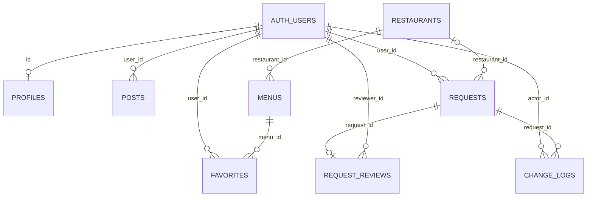

# Supabase + Vercel 배포

운영 주소는 **https://bob-pick.vercel.app**, Vercel 프로젝트는 `aaidan02/bob-pick`입니다. Supabase 초기 데이터·마이그레이션 7개·AI 함수가 적용되어 있습니다. 소스는 `feat/supabase-vercel-service` 브랜치이며 [PR #1](https://github.com/aaidan02/BOB-Pick/pull/1)에서 확인할 수 있습니다.

## 데이터 관계

공통 회원키는 Supabase Auth의 `auth.users.id`(UUID)입니다. `profiles.id`, `favorites.user_id`, `posts.user_id`, `requests.user_id`, `request_reviews.reviewer_id`, `change_logs.actor_id`가 같은 회원키를 참조합니다. 활동에는 자체 ID도 있어 한 회원이 여러 건을 작성할 수 있습니다.



음식점·메뉴는 회원과 독립적입니다. 신규 음식점은 승인 시 ID가 부여됩니다. 찜은 회원+메뉴가 유일하며 음식점은 메뉴를 통해 조회합니다. 비밀번호는 Auth가 관리하고 앱 테이블에 저장하지 않습니다.

## Supabase 설치

연결 프로젝트는 `rllfxdybuncooswotccs`입니다. 적용한 마이그레이션은 `supabase/migrations`에 기록합니다. 이미 적용한 SQL을 처음부터 다시 실행하지 않습니다.

다른 새 프로젝트는 Supabase CLI로 로그인·링크한 뒤 설치합니다.

```sh
supabase link --project-ref YOUR_PROJECT_REF
supabase db push --remote --yes
```

초기 데이터는 `supabase/seed.sql`을 SQL Editor나 연결한 DB에서 실행합니다. 큰 파일은 `restaurants` → `menus` → `holidays` 순서로 문장을 나누어 실행할 수 있습니다. CSV를 고쳐 초기 데이터를 다시 생성할 때만 `npm run data:export`를 사용합니다(JDK 21·Python 3). seed 재실행은 기존 행을 덮어쓰지 않습니다.

```sh
supabase functions deploy ai-recommend --no-verify-jwt
```

함수는 본문에서 Auth 서버의 `getUser(token)`으로 사용자 토큰을 검증합니다. 사용자 토큰으로 DB에 접근해 RLS를 유지하고 service-role 키를 사용하지 않습니다. 이 때문에 legacy JWT 게이트 대신 `verify_jwt=false`를 사용합니다.

**Edge Functions → Secrets**:

- `GEMINI_API_KEY`: 서버에서만 사용하는 Gemini 키.
- `GEMINI_MODEL`: 선택. 기본 `gemini-3.5-flash-lite`.
- `ALLOWED_ORIGINS`: 선택. 실제 사이트 origin을 쉼표로 구분.

## Vercel

GitHub `aaidan02/BOB-Pick`을 Import합니다. Node.js 24, Framework Vite, Root Directory 루트, Install `npm ci`, Build `npm run build`, Output `dist`를 사용합니다.

Production·Preview 환경에 `.env.example`의 공개 설정 3개를 등록하고 배포합니다. 환경변수를 바꿨다면 다시 빌드합니다. Gemini 키를 공개 변수에 등록하지 않습니다.

## 이메일 확인·비밀번호 재설정

서비스 URL 확정 후 Supabase **Authentication → URL Configuration**에 설정합니다.

- Site URL: `https://bob-pick.vercel.app`
- Redirect URLs: `https://bob-pick.vercel.app/**`, 개발용 `http://localhost:5173/**`

가입 확인·재설정 메일은 계정 화면으로 돌아옵니다. PKCE를 사용하므로 요청한 브라우저에서 메일 링크를 여는 방식으로 확인합니다. 로컬 대역 테스트는 실제 메일 전달을 검증하지 않습니다.

## 관리자 지정

운영 사이트에서 가입한 뒤 프로젝트 관리자가 SQL Editor에서 관리자 이메일을 지정합니다.

```sql
insert into private.admin_members(user_id)
select id from auth.users where lower(email)=lower('관리자 계정 이메일')
  and email_confirmed_at is not null and deleted_at is null
  and not coalesce(is_anonymous,false) and (banned_until is null or banned_until<=now())
on conflict(user_id) do nothing;
```

관리자는 다시 로그인하거나 계정 상태를 갱신하면 관리자 메뉴를 사용할 수 있습니다. 첫 가입자에게 자동으로 권한을 주지 않으며 사용자 메타데이터로 관리자 여부를 정하지 않습니다.

첫 관리자 연결 이후에는 **관리자 → 관리자 계정 관리**에서 이메일·닉네임으로 기존 회원을 검색해 권한을 추가·해제합니다. 이메일 인증을 마친 활성 회원에게만 추가할 수 있고, 마지막 관리자는 해제할 수 없습니다. 해제는 회원 계정 삭제와 별개이며 본인 권한을 해제하면 일반 회원 화면으로 이동합니다.

운영의 기존 `admin` 계정은 **마스터**로 지정했습니다. `private.admin_members.is_master`는 회원 ID에 고정되며 닉네임·이메일 변경이나 사용자 메타데이터로 이전되지 않습니다. 마스터는 한 명만 허용하고, 일반 관리자에게 마스터 지정·교체 API를 제공하지 않습니다. 본인과 다른 관리자의 해제 RPC를 차단하며 DB 트리거는 직접 DELETE·보호 값 변경·TRUNCATE와 Auth 삭제의 연쇄 삭제도 거부합니다. 일반 관리자의 추가·해제는 기존대로 가능합니다. DB 소유자는 신뢰 경계에 포함되며, DDL로 보호 규칙을 변경하는 권한까지 제한하지는 않습니다.

새 프로젝트의 마이그레이션은 실제 회원 ID를 포함하지 않습니다. 첫 운영자가 가입·인증하고 관리자 권한을 받은 다음, DB 소유자가 대상 이메일과 회원 ID를 확인해 `is_master=true`로 지정하고 `admin:master_assigned` 변경 이력을 함께 기록해야 합니다. 운영의 마스터 지정을 반복 실행하거나 테스트용 계정을 운영에 만들지 않습니다.

`admin_list_accounts`, `admin_search_accounts`, `admin_set_membership` RPC는 현재 DB의 관리자 여부를 직접 검사합니다. `auth.users` 이메일과 비공개 권한 테이블에 접근하기 위해 제한된 SECURITY DEFINER 함수를 사용하며 PUBLIC·anon 실행 권한은 회수합니다. 권한 변경은 테이블 잠금을 얻은 뒤 호출자의 자격을 다시 검사해 동시 해제로 관리자가 사라지는 것을 막고, 변경·이력 기록을 같은 트랜잭션에서 처리합니다. 변경 이력에는 대상 회원키·닉네임과 변경 전후 권한을 남기고 이메일은 복제하지 않습니다.

권한이 해제된 계정의 기존 로그인 토큰도 다음 서버 요청부터 관리자 자격을 인정받지 못합니다. 새로 추가된 계정은 화면을 새로고침하면 관리자 메뉴를 확인할 수 있습니다. 검색과 관리자 목록은 일반 회원·비로그인 사용자에게 공개하지 않습니다. Auth의 이메일 열은 실제 서비스와 같은 `varchar(255)`로 테스트하고, 조회 결과는 RPC의 `text` 반환형으로 명시적으로 변환합니다.

회원은 본인 찜·신청을 조회하고 본인 글을 수정·삭제합니다. 관리자는 다른 회원의 게시글도 삭제할 수 있으며 다른 사람 글의 수정은 허용하지 않습니다. 삭제는 글 ID로 요청하고 DB의 `posts_remove` RLS에서 작성자 또는 관리자 여부를 검사합니다. 관리자의 승인·반려는 데이터 반영·처리 기록·변경 이력을 한 트랜잭션으로 저장하며 중복 승인을 거부합니다. 비로그인 사용자는 공개 음식점·메뉴·게시글 조회와 수동 추천을 사용할 수 있습니다.

`request_reviews.request_id`는 UNIQUE 외래키이므로 PostgREST의 신청 내역 조회에서 `request_reviews`는 배열이 아닌 객체 또는 null입니다. 문의 내역과 관리자 목록은 이 형태를 처리하고, 브라우저 테스트 대역도 같은 관계 형태를 반환합니다. 사용자 화면에는 내부 JavaScript·DB 오류 대신 한국어 안내와 다시 시도할 수 있는 버튼을 표시합니다.

`is_admin`, `consume_ai_quota`, `submit_request`, `review_request`와 관리자 계정 RPC는 인증된 사용자에게만 실행을 허용합니다. Supabase의 [인증 사용자 SECURITY DEFINER 안내](https://supabase.com/docs/guides/database/database-linter?lint=0029_authenticated_security_definer_function_executable)에 해당하며 각 함수의 회원·관리자 검사와 고정 `search_path`를 유지합니다. `private.admin_members`와 `private.ai_usage`의 RLS에 허용 정책이 없는 것은 클라이언트의 직접 접근을 막기 위한 설정입니다.

## 네이버 지도

Naver Cloud Maps 애플리케이션의 Web 서비스 URL에 운영 origin을 추가하고 공개 client ID를 `VITE_NAVER_MAP_CLIENT_ID`에 설정합니다. 네이버 길찾기는 별도로 사용할 수 있으며 출발지에 임의 위치를 넣지 않습니다.

## 검증 범위

GitHub Actions는 웹 빌드·Edge 타입 검사·PostgreSQL/RLS·브라우저 테스트를 수행합니다. 로컬 대역 테스트와 실제 운영 메일·Gemini 모델 권한·지도 인증의 검증은 구분합니다. 실제 계정으로 가입·찜 재접속·신청·관리자 처리·AI 추천·휴대폰 접속을 확인합니다.
