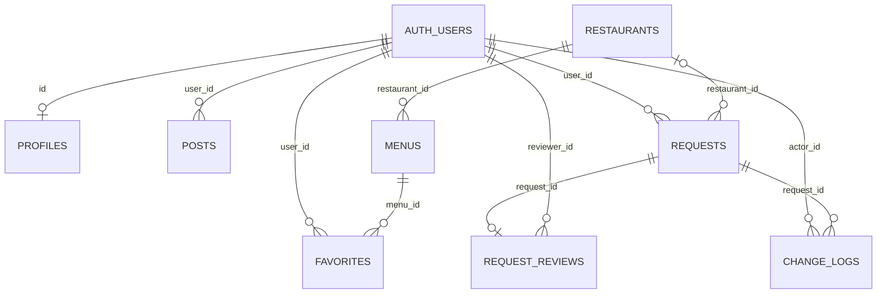

# Supabase + Vercel 배포

운영 주소는 **https://bob-pick.vercel.app**, Vercel 프로젝트는 `aaidan02/bob-pick`입니다. Supabase 초기 데이터와 회원·취향·기록·고객센터 스키마는 마이그레이션으로 관리합니다. 소스는 `feat/supabase-vercel-service` 브랜치이며 [PR #1](https://github.com/aaidan02/BOB-Pick/pull/1)에서 확인할 수 있습니다.

## 화면과 로컬 시안

승인된 로컬 시안의 배너·카드·빠른 이동 메뉴·회원/관리자 화면은 `web/src/theme.css`를 공유합니다. 운영 빌드는 실제 Supabase·Gemini·네이버 지도 연결을 유지합니다. 첫 홈페이지 방문에서 사용 안내를 자동으로 열고, 브라우저의 `bob-pick:help-seen:v1` 값으로 확인 여부만 저장합니다. 계정·약관 링크로 먼저 들어온 경우 홈페이지에 도착할 때 안내하며, 이후에도 `?`로 열 수 있습니다.

`npm run preview:ui`는 별도 로컬 주소 `http://localhost:4175`에서 같은 디자인을 임시 데이터베이스로 실행합니다. 역할 전환·AI 응답 예시·지도 그림은 이 시안 전용이며 운영 빌드에 포함되지 않습니다. 자세한 사용법은 [로컬 시안 안내](../ui-previews/emart-style/README.md)에 있습니다.

## 데이터 관계

공통 회원키는 Supabase Auth의 `auth.users.id`(UUID)입니다. `profiles.id`, `food_preferences.user_id`, `recommendation_history.user_id`, `support_tickets.user_id`, `favorites.user_id`, `posts.user_id`, `requests.user_id`, `request_reviews.reviewer_id`, `change_logs.actor_id`가 같은 회원키를 참조합니다. 활동에는 자체 ID도 있어 한 회원이 여러 건을 작성할 수 있습니다.



음식점·메뉴는 회원과 독립적입니다. 신규 음식점은 승인 시 ID가 부여됩니다. 찜은 회원+메뉴가 유일하며 음식점은 메뉴를 통해 조회합니다. 비밀번호는 Auth가 관리하고 앱 테이블에 저장하지 않습니다.

## Supabase 설치

연결 프로젝트는 `rllfxdybuncooswotccs`입니다. 적용한 마이그레이션은 `supabase/migrations`에 기록합니다. 이미 적용한 SQL을 처음부터 다시 실행하지 않습니다.

다른 새 프로젝트는 Supabase CLI로 로그인·링크한 뒤 설치합니다.

```sh
supabase link --project-ref YOUR_PROJECT_REF
supabase db push --remote --yes
```

초기 데이터는 `supabase/seed.sql`을 SQL Editor나 연결한 DB에서 실행합니다. 큰 파일은 `restaurants` → `menus` → `holidays` 순서로 문장을 나누어 실행할 수 있습니다. CSV를 고쳐 초기 데이터를 다시 생성할 때만 `npm run data:export`를 사용합니다(JDK 21·Python 3). seed 재실행은 기존 행을 덮어쓰지 않습니다.

```sh
supabase functions deploy ai-recommend --no-verify-jwt
supabase functions deploy delete-account --no-verify-jwt
```

두 함수는 본문에서 Auth 서버의 `getUser(token)`으로 사용자 토큰을 검증하므로 legacy JWT 게이트 대신 `verify_jwt=false`를 사용합니다. 음식점 조회·취향·사용 예약에는 검증한 사용자 토큰을 사용해 RLS를 유지합니다. AI 성공 정산과 본인 탈퇴에는 Edge 런타임의 기본 `SUPABASE_SERVICE_ROLE_KEY`를 서버 안에서만 사용하며, 이 키를 브라우저 설정이나 저장소에 넣지 않습니다.

**Edge Functions → Secrets**:

- `GEMINI_API_KEY`: 서버에서만 사용하는 Gemini 키.
- `GEMINI_MODEL`: 선택. 기본 `gemini-3.5-flash-lite`.
- `ALLOWED_ORIGINS`: 선택. 실제 사이트 origin을 쉼표로 구분.

## Vercel

GitHub `aaidan02/BOB-Pick`을 Import합니다. Node.js 24, Framework Vite, Root Directory 루트, Install `npm ci`, Build `npm run build`, Output `dist`를 사용합니다.

Production·Preview 환경에 `.env.example`의 공개 설정 3개를 등록하고 배포합니다. 환경변수를 바꿨다면 다시 빌드합니다. Gemini 키를 공개 변수에 등록하지 않습니다.

## 이메일 확인·비밀번호 재설정

서비스 URL 확정 후 Supabase **Authentication → URL Configuration**에 설정합니다.

- Site URL: `https://bob-pick.vercel.app`
- Redirect URLs: `https://bob-pick.vercel.app/**`, 개발용 `http://localhost:5173/**`

가입 확인·재설정 메일은 계정 화면으로 돌아옵니다. PKCE를 사용하므로 요청한 브라우저에서 메일 링크를 여는 방식으로 확인합니다. 로컬 대역 테스트는 실제 메일 전달을 검증하지 않습니다.

## 관리자 지정

운영 사이트에서 가입한 뒤 프로젝트 관리자가 SQL Editor에서 관리자 이메일을 지정합니다.

```sql
insert into private.admin_members(user_id)
select id from auth.users where lower(email)=lower('관리자 계정 이메일')
  and email_confirmed_at is not null and deleted_at is null
  and not coalesce(is_anonymous,false) and (banned_until is null or banned_until<=now())
on conflict(user_id) do nothing;
```

관리자는 다시 로그인하거나 계정 상태를 갱신하면 관리자 메뉴를 사용할 수 있습니다. 첫 가입자에게 자동으로 권한을 주지 않으며 사용자 메타데이터로 관리자 여부를 정하지 않습니다.

첫 관리자 연결 이후에는 **관리자 → 관리자 계정 관리**에서 이메일·닉네임으로 기존 회원을 검색해 권한을 추가·해제합니다. 이메일 인증을 마친 활성 회원에게만 추가할 수 있고, 마지막 관리자는 해제할 수 없습니다. 해제는 회원 계정 삭제와 별개이며 본인 권한을 해제하면 일반 회원 화면으로 이동합니다.

운영의 기존 `admin` 계정은 **마스터**로 지정했습니다. `private.admin_members.is_master`는 회원 ID에 고정되며 닉네임·이메일 변경이나 사용자 메타데이터로 이전되지 않습니다. 마스터는 한 명만 허용하고, 일반 관리자에게 마스터 지정·교체 API를 제공하지 않습니다. 본인과 다른 관리자의 해제 RPC를 차단하며 DB 트리거는 직접 DELETE·보호 값 변경·TRUNCATE와 Auth 삭제의 연쇄 삭제도 거부합니다. 일반 관리자의 추가·해제는 기존대로 가능합니다. DB 소유자는 신뢰 경계에 포함되며, DDL로 보호 규칙을 변경하는 권한까지 제한하지는 않습니다.

새 프로젝트의 마이그레이션은 실제 회원 ID를 포함하지 않습니다. 첫 운영자가 가입·인증하고 관리자 권한을 받은 다음, DB 소유자가 대상 이메일과 회원 ID를 확인해 `is_master=true`로 지정하고 `admin:master_assigned` 변경 이력을 함께 기록해야 합니다. 운영의 마스터 지정을 반복 실행하거나 테스트용 계정을 운영에 만들지 않습니다.

`admin_list_accounts`, `admin_search_accounts`, `admin_set_membership` RPC는 현재 DB의 관리자 여부를 직접 검사합니다. `auth.users` 이메일과 비공개 권한 테이블에 접근하기 위해 제한된 SECURITY DEFINER 함수를 사용하며 PUBLIC·anon 실행 권한은 회수합니다. 권한 변경은 테이블 잠금을 얻은 뒤 호출자의 자격을 다시 검사해 동시 해제로 관리자가 사라지는 것을 막고, 변경·이력 기록을 같은 트랜잭션에서 처리합니다. 변경 이력에는 대상 회원키·닉네임과 변경 전후 권한을 남기고 이메일은 복제하지 않습니다.

권한이 해제된 계정의 기존 로그인 토큰도 다음 서버 요청부터 관리자 자격을 인정받지 못합니다. 새로 추가된 계정은 화면을 새로고침하면 관리자 메뉴를 확인할 수 있습니다. 검색과 관리자 목록은 일반 회원·비로그인 사용자에게 공개하지 않습니다. Auth의 이메일 열은 실제 서비스와 같은 `varchar(255)`로 테스트하고, 조회 결과는 RPC의 `text` 반환형으로 명시적으로 변환합니다.

회원은 본인 찜·신청을 조회하고 본인 글을 수정·삭제합니다. 관리자는 다른 회원의 게시글도 삭제할 수 있으며 다른 사람 글의 수정은 허용하지 않습니다. 삭제는 글 ID로 요청하고 DB의 `posts_remove` RLS에서 작성자 또는 관리자 여부를 검사합니다. 관리자의 승인·반려는 데이터 반영·처리 기록·변경 이력을 한 트랜잭션으로 저장하며 중복 승인을 거부합니다. 비로그인 사용자는 공개 음식점·메뉴·게시글 조회와 수동 추천을 사용할 수 있습니다.

`request_reviews.request_id`는 UNIQUE 외래키이므로 PostgREST의 신청 내역 조회에서 `request_reviews`는 배열이 아닌 객체 또는 null입니다. 문의 내역과 관리자 목록은 이 형태를 처리하고, 브라우저 테스트 대역도 같은 관계 형태를 반환합니다. 사용자 화면에는 내부 JavaScript·DB 오류 대신 한국어 안내와 다시 시도할 수 있는 버튼을 표시합니다.

`is_admin`, `consume_ai_quota`, `ai_quota_status`, `submit_request`, `review_request`와 관리자 계정 RPC는 인증된 사용자에게만 실행을 허용합니다. Supabase의 [인증 사용자 SECURITY DEFINER 안내](https://supabase.com/docs/guides/database/database-linter?lint=0029_authenticated_security_definer_function_executable)에 해당하며 각 함수의 회원·관리자 검사와 고정 `search_path`를 유지합니다. `private.admin_members`와 `private.ai_usage`의 RLS에 허용 정책이 없는 것은 클라이언트의 직접 접근을 막기 위한 설정입니다.

## AI 횟수와 재검색

`ai_quota_status()`는 호출자 본인의 한국 날짜 기준 사용량·잔여량·다음 초기화 시각만 읽으며 횟수를 차감하지 않습니다. 새 AI 요청은 `begin_ai_request()`로 3분짜리 예약을 만들고, 실제 후보·메뉴 검증이 완료된 경우에만 서버 전용 `complete_ai_request()`가 1회를 정산합니다. 오류·확인 질문·후보 없음·취소는 성공 사용량에 넣지 않습니다. 정산 응답이 유실되면 서버가 한 번만 보상할 수 있고 브라우저는 정산·보상 API를 실행할 수 없습니다. 예전 `consume_ai_quota()`는 호환용으로 남지만 운영 AI 함수는 호출하지 않습니다. 기존 집계는 어떤 실패 요청 때문인지 구분할 수 없어 소급 변경하지 않습니다.

일반 회원은 하루 20회, 동시에 진행 중인 예약은 최대 3개이며 짧은 시간의 반복 요청도 제한합니다. 사용량과 진행 예약을 함께 잠가 동시 요청이 잔여 횟수를 초과하지 못하게 합니다. 관리자·마스터는 일일·동시·반복 횟수 제한에서 제외하며, DB의 현재 권한으로 판단합니다. 화면의 횟수는 로그인 변경·AI 요청 종료·창 재활성화와 한국 자정에 새로 확인합니다. ‘몰라 아무거나’는 실제 후보를 이용한 랜덤 추천으로 처리하고, 무의미한 문자열·음식과 무관한 질문은 추천을 만들지 않습니다.

수동 검색은 제출 시각을, AI는 서버가 해석한 정규화 조건을 결과와 함께 보관합니다. 공통 재검색 버튼은 이 조건을 `pick_restaurants`에 재사용하고 고정한 가게를 제외한 나머지만 다시 고릅니다. 입력창의 새 값이나 현재 시각으로 기존 결과의 기준을 바꾸지 않으며, Gemini를 추가 호출하거나 AI 횟수를 차감하지 않습니다. AI 함수의 `filter` 응답과 횟수 RPC를 먼저 적용한 뒤 웹 화면을 배포합니다.

## 내 정보·취향·기록·고객센터

회원가입에는 이메일·비밀번호·닉네임만 입력합니다. Auth 생성 시 빈 취향 행을 만들고, 가입·이메일 확인 후 실제 로그인 세션이 생기면 취향 설정을 별도 창으로 안내합니다. 저장하거나 ‘나중에 설정하기’를 누르면 계정별 완료 시각을 기록해 다른 브라우저에서도 자동으로 반복하지 않습니다. 기존 회원의 취향은 유지하며 가입 후 안내를 새로 띄우지 않습니다. 미완료 상태로 홈페이지를 새로 열어도 안내 창이 보이도록 숨겨진 계정 패널 밖에 배치합니다.

이후에는 내 정보의 ‘내 취향’에서 음식 종류 좋아요/피할래요, 좋아하는 형태, 제외할 메뉴 단어, 예산, 최근 방문 제외 기간을 수정합니다. 메인의 수동 검색·AI 채팅에 있는 ‘내 취향 반영’ 옆 ‘내 취향 설정’은 해당 탭을 바로 엽니다. 좋아요는 후보를 제한하지 않고 우선순위만 높이며, 피할래요·메뉴 이름에 포함된 제외 단어는 필수 제외입니다. 수동 검색은 화면에 보이는 예산을 사용하고 AI의 명시적인 예산은 저장 예산보다 우선합니다. 두 검색 모두 ‘내 취향 반영’을 끌 수 있습니다. 주변 검색은 등록 장소 사이의 직선거리만 계산하며 도보·차량 경로와 이동 시간은 계산하지 않습니다.

로그인 상태에서 실제 보여준 추천을 음식점·메뉴 ID로 기록합니다. 스냅샷은 서버가 실제 데이터로 생성하며 계정 전환 중에는 예상 회원 ID가 일치하는 요청만 저장합니다. 본인만 조회·삭제하고 ‘다녀왔어요’를 변경할 수 있습니다. 0/7/14/30일 제외는 추천 횟수가 아닌 직접 표시한 방문 시각을 기준으로 합니다. 방문하지 않은 추천은 최근 100건까지 보관하며 방문 기록은 자동 삭제하지 않습니다.

고객센터는 공개 FAQ와 회원별 비공개 1:1 문의로 나뉩니다. 본인과 관리자만 문의를 볼 수 있고 답변은 DB에서 현재 관리자 권한을 검사합니다. 문의 본문·답변을 HTML로 렌더링하지 않으며 변경 이력에는 본문을 복제하지 않습니다. 음식점 수정·등록·홍보는 기존 문의·신청 기능을 계속 사용합니다.

비밀번호 변경은 현재 비밀번호 재인증과 새 비밀번호 일치 확인을 거칩니다. 탈퇴는 `delete-account` 함수가 검증한 본인 JWT와 현재 비밀번호로만 신청합니다. 구버전 클라이언트 호환 이름을 유지하지만 즉시 Auth 계정을 삭제하지 않으며 `private.account_lifecycle`에 **7일**의 복원 기한을 저장합니다. 재시도해도 기한을 늘리지 않습니다. 탈퇴 상태에서는 회원 기능을 차단하고 공개 프로필·게시글을 숨깁니다. 7일 이내 로그인 후 비밀번호를 다시 확인하면 같은 회원키와 취향·찜·기록·게시글을 복원합니다. 기한이 지난 뒤에는 자동 삭제 대기 중이어도 복원을 거부합니다. 이미 영구 삭제한 계정은 복원하지 못합니다.

탈퇴·복원 상태 변경 RPC는 service-role에만 허용하고 브라우저는 실행하지 못합니다. 기존 소유권 RLS에 제한 정책을 추가하고 definer RPC의 쓰기에도 활성 계정 검사를 적용합니다. 탈퇴 도중 끝난 AI 요청은 성공 정산하지 않습니다. 탈퇴 시 갱신 세션을 모두 종료하고, 복원 시에는 다른 세션을 종료한 뒤 방금 비밀번호로 확인한 세션만 반환합니다. 복원 이력이 있는 계정은 `auth.sessions`의 실제 `session_id`도 검사하므로 만료 전 옛 JWT가 다시 권한을 얻지 못합니다. 마스터와 마지막 관리자는 계속 보호합니다.

회원 데이터는 회원 이용 기간과 탈퇴 신청 후 7일까지 보관합니다. AI 사용량은 한국 날짜 기준 최근 30일, 처리 예약은 생성 후 3일까지 보관하며 계정 영구 삭제 시 더 일찍 제거합니다. `pg_cron`의 `bob-pick-retention-cleanup`이 5분마다 서버 전용 `private.purge_expired_accounts()`를 실행합니다. 만료 계정을 잠근 뒤 Auth 사용자와 연결 정보를 삭제하고, 미처리 음식점 신청은 반려하고 개인 입력·원문·메모를 제거합니다. 반영된 음식점 정보와 익명 처리 이력은 유지합니다. 한 번에 만료 계정 최대 200개를 처리하며 다음 실행에서 나머지를 처리합니다. 실패한 작업은 Supabase Cron 이력에서 확인하고 다음 실행에서 재시도합니다. 외부 제공자 로그·백업의 보관 조건은 해당 제공자 정책을 따릅니다.

자동 파기 함수는 공개 API가 아니고 anon·authenticated·service-role의 직접 실행을 차단합니다. DB 소유자 역할의 Cron만 실행하며 API 비밀 키를 Cron에 저장하지 않습니다. 실제 회원을 테스트로 탈퇴·삭제하지 않습니다. 로컬 테스트 DB는 Auth와 세션 테이블, RLS 및 같은 상태 변경 함수를 사용합니다. 실제 이메일 전달과 외부 Auth 전송 자체는 로컬 대역의 검증 범위 밖입니다.

공개 게시글·프로필의 RLS는 `account_content_visible(UUID)`로 공개 가능 여부만 확인합니다. 이 함수는 이메일·탈퇴 시각·회원 정보를 반환하지 않으며 존재하지 않는 UUID도 공개 가능 값으로 처리합니다. [Public Can Execute SECURITY DEFINER Function](https://supabase.com/docs/guides/database/database-linter?lint=0028_anon_security_definer_function_executable) 안내는 공개 RLS에서 이 제한된 definer 함수를 사용하는 의도된 설정입니다. 탈퇴·복원 상태와 처리 시각은 본인 조회 또는 서버 전용 RPC에만 제공합니다.

## 인기 음식점·관리 내역 (2026-11-13)

넓은 화면에서는 메인 왼쪽 여백의 작은 사이드 패널에 검색 결과 횟수·방문 표시 회원 수·찜 회원 수 상위 음식점 세 곳을 각각 보여줍니다. 이름·순위·합계만 표시하고 전체 이름과 주소는 링크의 설명으로 제공합니다. 패널은 페이지 높이나 검색·지도 너비를 늘리거나 줄이지 않습니다. 왼쪽 여백이 부족한 1800px 미만 화면에서는 ‘동네 인기 TOP 3’ 버튼으로 접어 두며, 닫기·Escape·바깥 클릭·다른 페이지 이동으로 닫을 수 있습니다. 모바일 버튼은 하단 탐색 위에 배치합니다. 이 집계는 인기 표시 전용이며 수동·AI 추천의 후보·정렬·추첨 로직에 반영하지 않습니다. 기존 개인 취향 기능은 유지합니다.

검색 횟수는 로그인 회원의 실제 추천·조건검색 결과가 `save_recommendation_history`에 새로 저장된 횟수입니다. 새 statement trigger의 transition rows로 가게별 익명 합계를 더하며, 같은 이벤트의 네트워크 재시도는 중복 집계하지 않습니다. 기능 도입 전 데이터나 비회원 검색은 집계하지 않으며 화면에 실제 집계 시작일을 표시합니다. 개인 기록이 100건 제한으로 정리되거나 회원이 기록 삭제·탈퇴해도 회원키 없는 가게별 합계는 유지합니다. 방문·찜은 가게별 회원을 중복 제거해 집계하며 탈퇴 중·삭제·차단·익명 계정, 비활성 가게·메뉴를 제외합니다. `site_popularity()`는 가게 공개 정보·순위를 공개하며, 검색 횟수·방문 인원·찜 인원은 모두 현재 관리자에게만 반환합니다. 비회원·일반 회원은 세 집계의 숫자 필드 없이 같은 이름·순위를 받으며 투표한 회원 정보는 반환하지 않습니다.

관리자의 ‘승인 및 처리 내역’은 넓은 화면에서 왼쪽 문의·오른쪽 커뮤니티의 같은 너비 두 칸으로 보여줍니다. 두 목록은 높이를 제한하고 각 칸 안에서 독립적으로 스크롤하며, 좁은 화면에서는 문의·커뮤니티 탭으로 전환합니다. 관리 화면 진입·새로고침 때 보이는 목록을 모두 갱신하고 기존 수정·승인·반려·삭제·복원 권한은 유지합니다. 문의에는 음식점 신청·검토 내역과 비공개 고객센터 문의가 포함됩니다. 반려·대기 문의의 필드를 폼으로 수정하고 반려 건은 승인 대기로 돌려 다시 심사할 수 있습니다. 승인된 원문 payload 변경은 차단하고 새 정보 수정 신청으로 처리하여 승인 없이 음식점 정보가 바뀌지 않도록 합니다. 처리 사유·문의 메시지·고객센터 문의는 관리자 수정이 가능합니다.

게시글 삭제는 공개 목록에서 숨기는 방식으로 바뀌며, 관리자 검색에서 공개·삭제 상태별로 조회·수정·복원합니다. 삭제한 글을 수정하는 것만으로 공개하지 않습니다. 모든 수정 RPC는 현재 관리자·활성 계정, 예상 회원키와 행 revision을 검사합니다. 공개 관리 변경 로그에는 본문·메시지를 복제하지 않고 상태·revision만 남깁니다. 게시글 복원용 이전 원문·사진 ID는 별도 비공개 버전 테이블에만 보관하며 원문 영구 파기 시 함께 삭제합니다. 탈퇴 유예 종료 시 숨긴 원문도 계정 파기와 함께 실제 삭제됩니다. 이 기능 적용 전에 영구 삭제된 글은 복구할 수 없습니다.

마이그레이션 두 개를 먼저 적용하고 웹을 배포합니다. 구버전의 게시글 hard-delete 요청은 권한 오류로 거부되며, 새 클라이언트는 `set_post_visibility`를 호출합니다. `search_posts`는 revision 열을 추가하며 공개 검색에서 숨긴 글을 반환하지 않습니다. 운영 검증은 집계·권한 읽기만 수행하고 실제 회원의 문의나 글을 수정·삭제하지 않습니다.

## AI 음식 단서·등록명·주변 검색

AI 해석 전에 활성 음식점의 이름·지점·공개 좌표를 대조합니다. 띄어쓰기는 정규화하고 등록명은 메뉴 키워드나 이름 안의 업종으로 중복 적용하지 않습니다. ‘감성치킨’은 실제 등록명 ‘감성키친 서구점’·‘감성키친 도시락 서구점’과 구별하며 비슷한 이름은 음식점 이름(주소)으로만 표시하고 내부 ID는 안내하지 않습니다. 이름과 주소를 함께 입력하면 동일한 이름의 지점을 구분합니다. 후보가 한 곳이면 ‘이 음식점이 맞나요?’로 확인하고 ‘네·맞아요’ 같은 긍정 답변으로 검색을 이어갑니다. 여러 후보는 이름·주소로 선택해야 하며 단순한 긍정 답변으로 임의 선택하지 않습니다. 선택 답변은 바로 앞 질문의 검색·주변 조건을 유지하고 오래된 다른 주변 요청을 다시 적용하지 않습니다. 확인 질문 자체는 성공 사용량에 포함하지 않습니다. 음식 단서가 있는 반복·오타는 ‘밥’ 같은 실제 음식 형태로 연결하고, 단서가 없는 자모·무의미한 입력은 추천과 성공 횟수를 만들지 않습니다.

‘미향일식 근처 카페’와 ‘특정 카페와 가까운 음식점’은 기준 장소와 찾을 업종을 분리합니다. 기준 가게가 모호하거나 좌표가 없으면 확인을 요청합니다. SQL은 등록 좌표로 구면상 직선거리(m)를 계산하고 기준 가게 자체·좌표 없는 후보를 제외합니다. 음식점 요청에서는 카페 업종을 제외하며 구체적인 종류·메뉴·가격·영업시간·회피 조건을 유지합니다. 명시한 반경은 50km 이내에서 검증해 적용하고 거리순으로 후보를 고릅니다. 거리 요청이 없는 검색의 랜덤·개인 취향 동작은 유지합니다.

거리 결과에는 기준 장소와 직선거리만 표시합니다. 실제 이동 거리·시간 또는 현재 GPS 위치로 표현하지 않습니다. 재검색은 같은 기준 장소·반경·방문 시각을 보관하며 고정한 가게를 유지하고 나머지 가까운 새 가게를 고릅니다. Gemini를 추가 호출하거나 AI 횟수를 더 차감하지 않습니다. 이름은 확인됐지만 시간 때문에 제외된 경우에는 ‘없는 가게’ 대신 영업시간 조건을 안내합니다. 예산·영업시간을 자동 완화하지 않습니다.

## 네이버 지도

Naver Cloud Maps 애플리케이션의 Web 서비스 URL에 운영 origin을 추가하고 공개 client ID를 `VITE_NAVER_MAP_CLIENT_ID`에 설정합니다. 네이버 길찾기는 별도로 사용할 수 있으며 출발지에 임의 위치를 넣지 않습니다.

지도는 숨겨진 화면에서 생성하지 않고 컨테이너의 너비·높이가 확보된 뒤 초기화합니다. `ResizeObserver`와 화면 복귀 이벤트에서 공식 [`autoResize()`·`refresh()`](https://navermaps.github.io/maps.js.ncp/docs/naver.maps.Map.html)를 호출하며, 새 레이아웃을 반영한 뒤 선택 가게의 범위를 맞춥니다. 지도 인스턴스는 재사용하고 일반 화면 복귀에서는 현재 중심과 줌을 유지합니다. 여러 가게가 선택된 상태에서 너비가 바뀌면 선택 가게가 함께 보이도록 범위를 다시 맞춥니다.

회귀 검사는 지도 SDK의 뷰포트 캐시를 모델링한 대역을 사용하며, 수정 전에는 너비 전환과 숨겨진 초기화 사례가 실패하고 수정 후에는 통과하는 것을 확인했습니다. 실행 환경의 프록시가 `oapi.map.naver.com` SDK 요청을 403으로 차단하므로 실제 네이버 인증·타일 응답은 이 검사에 포함하지 않습니다.

## 검증 범위

GitHub Actions는 웹 빌드·Edge 타입 검사·PostgreSQL/RLS·브라우저 테스트를 수행합니다. 로컬 대역 테스트와 실제 운영 메일·Gemini 모델 권한·지도 인증의 검증은 구분합니다. 실제 계정으로 가입·찜 재접속·신청·관리자 처리·AI 추천·휴대폰 접속을 확인합니다.

2026-11-13 검증 범위는 PostgreSQL/RLS·추천·정산·탈퇴·길찾기·복원·사진 56개와 브라우저 37개입니다. 삭제 원문 수정·별도 복원·반려 문의 재검토·동시 수정 방지·관리자 전용 권한·익명 집계·중복 제거·모바일 표시를 추가로 확인합니다. 가입 후 안내의 저장·건너뛰기·이메일 확인 후 안내·계정 간 접근 차단·기존 취향 보존·모바일 바로가기도 포함합니다. 브라우저의 AI·탈퇴·사진 경로는 운영과 같은 공유 처리 함수를 호출하며 Gemini·Auth·Storage 전송은 로컬 대역으로 대체합니다. 사진 소유권·세 장 제한·현재 공개 상태·관리자 변경과 선택 복원·충돌/감사 실패 시 전체 롤백·탈퇴 후 실제 파일 삭제 큐를 검사합니다. 운영의 비공개 버킷 생성·정리 HTTP 200과 익명 업로드 거부·CORS도 별도로 확인합니다. 운영에서는 마이그레이션 18개, AI v7·탈퇴 v2·사진 v1 배포와 음식점/메뉴 수, 정산의 서버 전용 권한, 취향·기록·답변의 직접 쓰기 차단을 별도로 확인합니다.

Supabase 보안 점검의 [인증 사용자 definer 함수 안내](https://supabase.com/docs/guides/database/database-linter?lint=0029_authenticated_security_definer_function_executable)는 본인·관리자 검사를 거치는 의도된 API입니다. [정책 없는 RLS](https://supabase.com/docs/guides/database/database-linter?lint=0008_rls_enabled_no_policy)는 private 내부 테이블의 직접 접근 차단이며, 새 인덱스의 [미사용 안내](https://supabase.com/docs/guides/database/database-linter?lint=0005_unused_index)는 아직 사용 이력이 없다는 의미입니다. 기존 Auth의 [유출 비밀번호 검사 설정 안내](https://supabase.com/docs/guides/database/database-linter?lint=auth_leaked_password_protection)는 이번 배포에서 변경하지 않습니다.

## 관리자 복원 및 커뮤니티 사진 (2026-11-13)

- `community_photos`, `admin_restoration` 마이그레이션을 순서대로 적용하고 `community-media` Edge Function을 `verify_jwt=false`로 배포합니다. 함수 내부에서 로그인 토큰·현재 계정 상태·소유자/관리자 권한을 검증합니다. 공개 Storage 정책이나 서비스 키를 브라우저에 추가하지 않습니다.
- 운영 DB 소유자 권한으로 `private.media_config.function_url`에 해당 프로젝트의 `https://<project-ref>.supabase.co/functions/v1/community-media` 주소를 설정합니다. `pg_cron`, `pg_net`으로 5분마다 정리 작업을 호출하며 매번 비공개 일회용 티켓을 발급합니다. 티켓이나 service-role 키를 Cron SQL에 고정해 넣지 않습니다.
- `community-images`는 비공개 버킷입니다. 첫 업로드 또는 승인된 정리 호출에서 Storage API로 생성하며 JPG·PNG·WebP, 파일당 5MB만 허용합니다. 데이터베이스에서 `storage.objects`를 직접 수정하지 않습니다.
- 게시글 사진은 현재 공개 상태와 계정 상태를 확인한 뒤 Edge가 반환합니다. 원본 파일명·회원 ID를 객체 경로에 넣지 않으며, 브라우저의 서명 URL·공개 URL 저장 없이 `no-store`로 제공합니다. 사진 제거·숨김 후에도 복원에 필요한 파일은 비공개로 보관합니다.
- 관리자 게시글 변경 전 원문과 사진 ID는 `private.post_versions`, 가게·전체 메뉴의 변경 전 정보는 `private.catalog_versions`에 저장합니다. 복원에도 새 이력을 남기므로 다시 되돌릴 수 있습니다. 전체 사이트 롤백이나 회원 권한 복원 기능이 아닙니다.
- 탈퇴 7일 경과 시 게시글·이전 원문·사진 메타데이터를 함께 지우고 객체 키를 정리 큐에 넣습니다. Edge가 Storage API로 실제 파일을 제거한 후에만 큐를 비웁니다. 실패한 작업은 다음 주기에 재시도하며 미첨부 업로드는 하루 뒤 정리합니다.
- 복원 RPC는 현재 관리자와 요청자의 일치, 수정 버전/전체 가게 스냅샷의 일치를 확인합니다. 1~20개 선택 복원은 한 트랜잭션으로 실행해 일부만 반영되는 것을 막습니다. 작성자가 탈퇴 중인 글과 영구 삭제된 데이터는 관리자도 복원하지 못합니다.


## 강제 탈퇴와 검색 횟수 공개 범위 (2026-11-16)

- 관리자 화면의 접힌 ‘사용자 계정 관리’에서 이메일·닉네임과 상태로 검색합니다. 사유 2~500자 입력과 대상·7일 보관 안내 확인 후 강제 탈퇴합니다. 처리·취소는 현재 관리자·예상 작업자·대상 revision을 검사하고 상태와 로그를 한 트랜잭션으로 변경합니다. 본인·마스터·관리자 계정은 강제 탈퇴할 수 없으며 일반 관리자는 먼저 권한을 해제해야 합니다.
- `private.account_lifecycle`에 관리자 처리 구분·비공개 사유·처리자·세션 기준 시각·revision을 추가합니다. 기존 7일 파기 Cron과 사진 정리를 재사용합니다. 본인이 이미 탈퇴한 계정을 강제로 전환해도 최초 파기 기한은 연장하지 않습니다. 사유는 영구 로그에 복제하지 않고 취소/영구 파기 시 삭제하며, 로그의 대상 회원키도 영구 파기 때 익명화합니다.
- 사용자에게는 계정 안내 화면에서 본인 처리 사유와 운영자 연락처만 보여줍니다. 강제 탈퇴는 본인 복원 RPC에서도 거부합니다. 관리자만 기한 안에 취소할 수 있고 `auth.sessions.created_at`과 비공개 기준 시각을 비교하므로 이전 로그인 세션은 취소 후에도 회원 API에 접근하지 못합니다. 회원은 다시 로그인해야 합니다. Auth 내부 테이블에 새 쓰기나 공개 권한을 추가하지 않습니다.
- 기존 관리자 목록·검색·권한 변경에도 현재 활성 관리자 검사를 적용합니다. 탈퇴 중인 회원에게 관리자 권한을 추가해 제한을 우회할 수 없게 합니다.
- `site_popularity()`는 실제 순위를 유지하고 관리자에게만 세 집계의 `metric_count`를 반환합니다. 일반 회원·비회원은 세 집계 모두 이 필드가 없으며 `canViewCounts=false`입니다. 화면도 계정 전환/로그아웃 즉시 기존 검색 횟수를 지우고 권한에 맞게 다시 읽습니다.
- PostgreSQL/RLS·단위 60개와 브라우저 39개로 강제 탈퇴·취소·이전 세션 거부·자기 복원 우회 차단·관리자 보호·감사 실패 롤백·기한 유지·영구 파기 및 검색 횟수의 회원/비회원/관리자 응답과 로그아웃을 검사합니다. 운영에서 실제 계정을 강제 탈퇴시키거나 복원하는 검증은 하지 않습니다.

운영 마이그레이션은 총 19개입니다. 이번 변경은 DB·웹에 적용하며 AI v7·계정 탈퇴 v2·사진 v1 Edge와 기존 파기 Cron은 유지합니다.


## 관리자 명단 유지·집계 비공개·탈퇴 문단 (2026-11-16)

같은 계정의 창 복귀·로그인 상태 재확인 때 `identity-changed`가 반복 발생해 관리자 목록·검색 결과를 지웠지만, 관리자 화면은 계정·권한이 바뀌지 않으면 다시 조회하지 않아 0명으로 보였습니다. 해당 상황을 브라우저 테스트로 재현한 뒤 관리자 목록 초기화를 실제 계정 또는 권한 변경에만 수행하도록 수정했습니다. 로그아웃·권한 해제 때는 기존처럼 즉시 데이터를 지우며 같은 계정의 조회 결과와 검색 내용은 유지합니다.

인기 음식점의 검색·방문·찜 세 집계는 이름·순위만 공개합니다. 현재 관리자만 `metric_count`를 받고, 일반 회원·비회원 응답에서는 세 배열 모두 숫자 필드를 제거합니다. 계정 전환 시 기존 숫자 표시는 즉시 지웁니다. API는 `canViewCounts`를 추가하고 기존 `canViewSearchCounts`도 같은 권한값으로 유지합니다. 집계 순서·원본 합계·추천 로직은 변경하지 않습니다.

강제 탈퇴 계정 화면의 사유와 ‘복원은 운영자만 처리할 수 있습니다’ 안내는 별도 문단으로 출력합니다. 390/320px에서 사유 아래 배치와 가로 넘침 없음을 검사합니다. 단위/DB 60개와 브라우저 40개로 관리자 명단 재확인·권한 해제와 계정 전환·세 집계 응답·강제 탈퇴 안내를 함께 검증합니다. 운영 계정의 권한과 탈퇴 상태를 복구하거나 변경하는 작업은 하지 않습니다.

현재 운영 마이그레이션은 20개이며, 집계 조회 함수만 갱신합니다. 이번 수정에서 운영 계정의 관리자 권한이나 탈퇴 상태를 변경하지 않습니다.


## 가입 이메일·인증 정보 파기 (2026-11-17)

기존 7일 탈퇴 유예와 5분 주기 파기 Cron을 유지합니다. `auth.users` 영구 삭제 시 가입 이메일·비밀번호 검증 정보·인증 확인 필드는 해당 행과 함께 사라지고, 실제 운영 FK의 ON DELETE CASCADE에 따라 identities·one_time_tokens·MFA·sessions·세션에 연결된 refresh_tokens를 삭제합니다. SQL 삭제 뒤에도 JWT 서명은 만료까지 유효할 수 있으므로 회원 기능은 기존 `is_active_member()`의 Auth 사용자 존재 여부 검사로 거부합니다.

운영에서 `auth.flow_state.user_id`에는 사용자 FK가 없고 `auth.refresh_tokens.session_id`는 NULL을 허용함을 읽기 조회로 확인했습니다. 영구 파기 트리거에 대상 UID가 정확히 일치하는 인증 임시 상태와 전체 갱신 토큰 정리를 추가합니다. 로그인 차단만 이루어지는 7일 유예 중에는 복원에 필요한 이메일·인증 계정을 먼저 지우지 않습니다. 파기 중 오류가 발생하면 이메일·인증·서비스 데이터의 삭제를 한 트랜잭션으로 롤백합니다.

일반 회원·비회원에게 Auth 테이블 접근이나 파기 함수를 공개하지 않고, 기존 마스터·마지막 관리자 보호도 유지합니다. 관리형 Auth 스키마에 새로운 테이블·인덱스·공개 권한을 추가하지 않습니다. 제공자의 보안 로그·백업·이미 발송된 이메일에는 각 제공자 보관 정책이 적용되며 사용자 메일함의 메일을 지우는 기능은 아닙니다.

합성 Auth 데이터로 이메일·검증 정보·identity·인증 토큰·MFA·세션·세션 없는 이전 갱신 토큰·인증 임시 상태의 파기와 다른 계정 보존, 7일 유예 중 보관, 실패 시 전체 롤백과 마스터 보호를 검사합니다. 실제 운영 계정을 삭제해 검증하지 않습니다. 기존 무료 서비스와 Cron을 사용하고 유료 플랜·부가 기능을 추가하지 않습니다.

운영 마이그레이션은 총 21개입니다. 단위/DB 62개와 브라우저 40개, 웹 빌드 및 Edge 함수 3종 타입 검사를 통과했습니다. 기존 공개 API·권한·7일 파기 일정과 관리자 계정은 유지합니다.
## Cloudflare Turnstile 연결 (2026-11-17)

- 새 패키지나 유료 기능 없이 Cloudflare의 공식 SDK와 기존 Vite·TypeScript·Supabase Auth를 사용합니다. 공개 사이트 키는 Vercel의 `VITE_TURNSTILE_SITE_KEY` production 설정만 사용하고, 비밀 키는 Supabase Auth Protection에 직접 저장합니다. 비밀 키를 모델·Git·브라우저에 전달하지 않습니다.
- SDK는 인증 폼 제출 시에만 불러옵니다. 관리형 검사와 한국어 안내, 좁은 화면의 compact 크기, 로드 실패·검사 오류·만료·제한 시간과 화면/폼 변경 시 취소를 처리합니다. 보안 검사 실패 시 Auth 요청을 보내지 않습니다. 매 요청마다 새 위젯·토큰을 사용하고 완료·실패 후 제거합니다.
- 가입·로그인·비밀번호 재설정은 `captchaToken`을 Supabase JS에 전달합니다. 로그인 상태의 비밀번호 변경도 새 토큰으로 현재 비밀번호를 재확인합니다. 탈퇴·복원은 Edge의 기존 사용자 토큰 검사·대상 계정 검사와 비밀번호 확인을 유지하고, 입력한 CAPTCHA 토큰을 비밀번호 확인 호출에 전달합니다. Supabase Auth가 Cloudflare에 한 번 검증하므로 별도 Siteverify 요청으로 같은 토큰을 미리 소모하지 않습니다.
- 공개 키가 없는 개발 환경은 기존 동작을 유지합니다. 서버 보호를 켠 운영 Auth는 토큰 누락·위조를 거부하므로 프런트엔드 설정을 끄는 것으로 우회할 수 없습니다. 운영 호스트가 아닌 별칭·로컬에서 실제 Auth를 사용하려면 해당 호스트를 Cloudflare에 등록하고 올바른 개발용 사이트 키도 설정해야 합니다. 테스트 전용 키·SDK·Auth 대역은 Playwright 안에서만 사용합니다.
- 자동 검증의 Auth 대역은 누락·재사용 토큰을 거부합니다. 기존 가입·비밀번호 변경·탈퇴·7일 복원 흐름을 이 조건에서 검증하고, 수동 검사 대기·폼 변경 취소·320px·토큰 만료·오류·광고 차단과 재시도·새 토큰·재설정 메일 요청을 추가 검증합니다. 제공자에게 실제 회원 가입·메일 발송·탈퇴를 실행하는 자동 테스트는 하지 않습니다.
- 운영 적용 순서: 웹/Edge와 공개 키 배포 → Cloudflare 위젯 호스트 확인 → Supabase Auth Protection에서 Turnstile 선택·비밀 키 저장·CAPTCHA 활성화 → 실제 사용자 브라우저로 로그인·가입·재설정과 계정 본인 확인을 확인합니다. 코드 배포만으로 서버 CAPTCHA가 활성화됐다고 판단하지 않습니다. 개인정보처리방침에 Cloudflare 처리 정보·일회용 토큰의 DB 미보관과 제공자 정책 링크를 추가합니다.

단위/DB 63개·브라우저 44개와 웹 빌드·Edge 3종 타입 검사를 통과했습니다. DB 마이그레이션은 기존 21개를 유지합니다. 실제 Cloudflare/운영 Auth의 검증은 비밀 키를 Supabase에 저장하고 보호를 켠 뒤 사용자 브라우저에서 확인해야 합니다.
## 관리자 보안 검사 페이지 (2026-11-17)

`#security-check`를 관리자 화면의 ‘보안 검사’로 연결합니다. 비회원·일반 회원에게 검사 내용을 숨기고, 실행할 때 현재 `is_admin()`도 다시 확인합니다. 계정·권한 변경과 로그아웃은 이전 결과를 지우며 화면 이동은 진행 중인 검사·위젯을 취소합니다. 연속 실행에는 5초 간격을 둡니다.

실제 검사는 브라우저에서 운영 Auth `/token?grant_type=password`에 익명 POST를 보냅니다. 현재 Supabase 로그인 클라이언트를 사용하지 않고 임의 UUID의 `example.invalid` 이메일과 매번 새 무작위 비밀번호를 생성합니다. CAPTCHA 검증은 `/token`의 자격 증명 검사 앞에서 실행되므로 정상 토큰의 `invalid_credentials`와 없는/잘못된/재사용 토큰의 `captcha_failed`를 구분합니다. 정상 인증 검사는 토큰 없는 요청이 실제로 거부되는지도 함께 확인해야 통과합니다. 429·예상 밖 상태·네트워크 오류는 통과 처리하지 않습니다. 원문 토큰·응답·임의 비밀번호를 화면·DB에 저장하거나 인증 세션에 반영하지 않습니다. 이 검사에서는 회원가입·재설정 메일·계정 변경·AI 호출을 실행하지 않습니다. Auth 제공자의 요청 로그·요청 제한은 정상적으로 적용됩니다.

실패·만료 안내 미리보기는 ‘화면 예시’로 명시하고 서버 요청과 통과 집계에서 제외합니다. 공식 테스트 키를 운영 로그인에 사용하거나 CAPTCHA 검증을 우회하는 서버 기능을 추가하지 않습니다. DB·Edge·비밀 키·플랜 변경 없이 기존 공개 키와 Auth를 사용합니다.

검증: 요청의 익명성·무작위 자격 증명·응답 분류·제한·예상 밖 성공 응답 및 취소를 단위 검사합니다. 브라우저에서 4개 검사, 보호 미설정·429·권한 해제의 통과 방지, 일반 회원 차단·로그아웃 초기화, 기존 계정·AI 사용량 보존과 320px 화면을 확인합니다. 로컬 SDK/Auth 대역의 결과는 운영 Cloudflare 검증 결과와 구분합니다.

웹 빌드·단위/DB 66개·브라우저 47개를 통과했습니다. PC/320px 화면을 캡처해 확인했습니다. Supabase DB 21개 마이그레이션과 AI v7·delete-account v3·community-media v1 및 기존 비밀 키·무료 플랜은 유지합니다.
## 보안 검사 응답 형식 수정 (2026-11-17)

운영 요청 로그에서 `/auth/v1/token`은 `captcha_failed` HTTP 400과 `invalid_credentials` HTTP 400을 정상 반환했지만 검사 페이지에서는 알 수 없는 응답으로 표시됐습니다. 요청에 Auth API 버전을 지정하지 않았고, 이전 응답 형식의 숫자 `code: 400`을 문자열 오류 이름보다 먼저 선택한 것이 원인입니다. 일반 로그인 SDK와 같은 `X-Supabase-Api-Version: 2024-01-01`을 지정하고 문자열 `code`·문자열 `error_code`를 구분합니다. 숫자 HTTP 코드는 오류 이름으로 사용하지 않으며, 코드가 없는 구형 응답은 공식 Auth의 제한된 `msg` 형식으로 판별합니다. 429·인프라 오류·예상 밖 응답을 통과로 처리하지 않는 기준과 익명 요청·세션 미저장은 유지합니다.

수정 전 숫자 code/문자열 error_code 응답을 재현하는 단위 검사가 `unknown != rejected`로 실패함을 확인했습니다. Auth 대역은 요청 API 버전에 맞는 최신/이전 오류 형식을 반환하도록 개선하고, 브라우저에서 숫자 code를 포함한 운영 형식과 실제 인증·누락 차단 결과를 검증합니다. DB·Edge·CAPTCHA 설정·비밀 키·요금제를 변경하지 않습니다.
## 운영 연결 지연과 검사 보류 (2026-11-17)

사용자 콘솔에서 관리자 확인·계정 상태·취향·찜 등 Data API 요청의 CORS 오류를 확인했습니다. 운영 게이트웨이 로그에는 해당 요청의 HTTP 522(원본 서버 연결 시간 초과)가 기록됐고, 이후 동일 API들은 다시 HTTP 200으로 응답했습니다. Supabase 프로젝트도 ACTIVE_HEALTHY 상태였습니다. 오류 응답에 정상 CORS 헤더가 없어 브라우저에서 CORS 오류로 표시된 것이며, 이 사실만으로 CAPTCHA 보호 설정이나 회원 권한을 변경하지 않습니다.

검사 전 현재 관리자 확인은 10초 안에 완료하도록 제한합니다. 권한 거부는 기존처럼 차단하고, 조회 연결 실패·인증 API 연결 지연·429·예상 밖 응답은 ‘확인 보류’로 구분합니다. 보류된 검사는 통과 개수에 넣지 않고 별도 개수를 표시합니다. 권한을 확인할 수 없을 때 익명 인증 검사를 진행하지 않습니다. 서버가 회복된 뒤 같은 버튼으로 다시 검사할 수 있습니다.

브라우저 회귀 검사는 Data API 연결 실패 때 네 항목 모두 보류되고 Auth 요청이 전송되지 않는지, 회복 후 재검사가 통과하는지, 522를 보안 실패나 통과로 처리하지 않는지 확인합니다. 기존 응답 형식 수정과 보호 미설정 감지는 유지합니다. SDK·DB·Edge·CORS 설정·RLS·비밀 키·플랜은 변경하지 않습니다.
