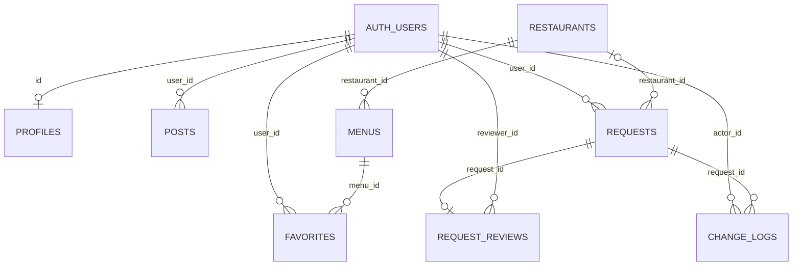

# Supabase + Vercel 배포

운영 주소는 **https://bob-pick.vercel.app**, Vercel 프로젝트는 `aaidan02/bob-pick`입니다. Supabase 초기 데이터와 회원·취향·기록·고객센터 스키마는 마이그레이션으로 관리합니다. 소스는 `feat/supabase-vercel-service` 브랜치이며 [PR #1](https://github.com/aaidan02/BOB-Pick/pull/1)에서 확인할 수 있습니다.

## 화면과 로컬 시안

승인된 로컬 시안의 배너·카드·빠른 이동 메뉴·회원/관리자 화면은 `web/src/theme.css`를 공유합니다. 운영 빌드는 실제 Supabase·Gemini·네이버 지도 연결을 유지합니다. 첫 홈페이지 방문에서 사용 안내를 자동으로 열고, 브라우저의 `bob-pick:help-seen:v1` 값으로 확인 여부만 저장합니다. 계정·약관 링크로 먼저 들어온 경우 홈페이지에 도착할 때 안내하며, 이후에도 `?`로 열 수 있습니다.

`npm run preview:ui`는 별도 로컬 주소 `http://localhost:4175`에서 같은 디자인을 임시 데이터베이스로 실행합니다. 역할 전환·AI 응답 예시·지도 그림은 이 시안 전용이며 운영 빌드에 포함되지 않습니다. 자세한 사용법은 [로컬 시안 안내](../ui-previews/emart-style/README.md)에 있습니다.

## 데이터 관계

공통 회원키는 Supabase Auth의 `auth.users.id`(UUID)입니다. `profiles.id`, `food_preferences.user_id`, `recommendation_history.user_id`, `support_tickets.user_id`, `favorites.user_id`, `posts.user_id`, `requests.user_id`, `request_reviews.reviewer_id`, `change_logs.actor_id`가 같은 회원키를 참조합니다. 활동에는 자체 ID도 있어 한 회원이 여러 건을 작성할 수 있습니다.



음식점·메뉴는 회원과 독립적입니다. 신규 음식점은 승인 시 ID가 부여됩니다. 찜은 회원+메뉴가 유일하며 음식점은 메뉴를 통해 조회합니다. 비밀번호는 Auth가 관리하고 앱 테이블에 저장하지 않습니다.

## Supabase 설치

연결 프로젝트는 `rllfxdybuncooswotccs`입니다. 적용한 마이그레이션은 `supabase/migrations`에 기록합니다. 이미 적용한 SQL을 처음부터 다시 실행하지 않습니다.

다른 새 프로젝트는 Supabase CLI로 로그인·링크한 뒤 설치합니다.

```sh
supabase link --project-ref YOUR_PROJECT_REF
supabase db push --remote --yes
```

초기 데이터는 `supabase/seed.sql`을 SQL Editor나 연결한 DB에서 실행합니다. 큰 파일은 `restaurants` → `menus` → `holidays` 순서로 문장을 나누어 실행할 수 있습니다. CSV를 고쳐 초기 데이터를 다시 생성할 때만 `npm run data:export`를 사용합니다(JDK 21·Python 3). seed 재실행은 기존 행을 덮어쓰지 않습니다.

```sh
supabase functions deploy ai-recommend --no-verify-jwt
supabase functions deploy delete-account --no-verify-jwt
```

두 함수는 본문에서 Auth 서버의 `getUser(token)`으로 사용자 토큰을 검증하므로 legacy JWT 게이트 대신 `verify_jwt=false`를 사용합니다. 음식점 조회·취향·사용 예약에는 검증한 사용자 토큰을 사용해 RLS를 유지합니다. AI 성공 정산과 본인 탈퇴에는 Edge 런타임의 기본 `SUPABASE_SERVICE_ROLE_KEY`를 서버 안에서만 사용하며, 이 키를 브라우저 설정이나 저장소에 넣지 않습니다.

**Edge Functions → Secrets**:

- `GEMINI_API_KEY`: 서버에서만 사용하는 Gemini 키.
- `GEMINI_MODEL`: 선택. 기본 `gemini-3.5-flash-lite`.
- `ALLOWED_ORIGINS`: 선택. 실제 사이트 origin을 쉼표로 구분.

## Vercel

GitHub `aaidan02/BOB-Pick`을 Import합니다. Node.js 24, Framework Vite, Root Directory 루트, Install `npm ci`, Build `npm run build`, Output `dist`를 사용합니다.

Production·Preview 환경에 `.env.example`의 공개 설정 3개를 등록하고 배포합니다. 환경변수를 바꿨다면 다시 빌드합니다. Gemini 키를 공개 변수에 등록하지 않습니다.

## 이메일 확인·비밀번호 재설정

서비스 URL 확정 후 Supabase **Authentication → URL Configuration**에 설정합니다.

- Site URL: `https://bob-pick.vercel.app`
- Redirect URLs: `https://bob-pick.vercel.app/**`, 개발용 `http://localhost:5173/**`

가입 확인·재설정 메일은 계정 화면으로 돌아옵니다. PKCE를 사용하므로 요청한 브라우저에서 메일 링크를 여는 방식으로 확인합니다. 로컬 대역 테스트는 실제 메일 전달을 검증하지 않습니다.

## 관리자 지정

운영 사이트에서 가입한 뒤 프로젝트 관리자가 SQL Editor에서 관리자 이메일을 지정합니다.

```sql
insert into private.admin_members(user_id)
select id from auth.users where lower(email)=lower('관리자 계정 이메일')
  and email_confirmed_at is not null and deleted_at is null
  and not coalesce(is_anonymous,false) and (banned_until is null or banned_until<=now())
on conflict(user_id) do nothing;
```

관리자는 다시 로그인하거나 계정 상태를 갱신하면 관리자 메뉴를 사용할 수 있습니다. 첫 가입자에게 자동으로 권한을 주지 않으며 사용자 메타데이터로 관리자 여부를 정하지 않습니다.

첫 관리자 연결 이후에는 **관리자 → 관리자 계정 관리**에서 이메일·닉네임으로 기존 회원을 검색해 권한을 추가·해제합니다. 이메일 인증을 마친 활성 회원에게만 추가할 수 있고, 마지막 관리자는 해제할 수 없습니다. 해제는 회원 계정 삭제와 별개이며 본인 권한을 해제하면 일반 회원 화면으로 이동합니다.

운영의 기존 `admin` 계정은 **마스터**로 지정했습니다. `private.admin_members.is_master`는 회원 ID에 고정되며 닉네임·이메일 변경이나 사용자 메타데이터로 이전되지 않습니다. 마스터는 한 명만 허용하고, 일반 관리자에게 마스터 지정·교체 API를 제공하지 않습니다. 본인과 다른 관리자의 해제 RPC를 차단하며 DB 트리거는 직접 DELETE·보호 값 변경·TRUNCATE와 Auth 삭제의 연쇄 삭제도 거부합니다. 일반 관리자의 추가·해제는 기존대로 가능합니다. DB 소유자는 신뢰 경계에 포함되며, DDL로 보호 규칙을 변경하는 권한까지 제한하지는 않습니다.

새 프로젝트의 마이그레이션은 실제 회원 ID를 포함하지 않습니다. 첫 운영자가 가입·인증하고 관리자 권한을 받은 다음, DB 소유자가 대상 이메일과 회원 ID를 확인해 `is_master=true`로 지정하고 `admin:master_assigned` 변경 이력을 함께 기록해야 합니다. 운영의 마스터 지정을 반복 실행하거나 테스트용 계정을 운영에 만들지 않습니다.

`admin_list_accounts`, `admin_search_accounts`, `admin_set_membership` RPC는 현재 DB의 관리자 여부를 직접 검사합니다. `auth.users` 이메일과 비공개 권한 테이블에 접근하기 위해 제한된 SECURITY DEFINER 함수를 사용하며 PUBLIC·anon 실행 권한은 회수합니다. 권한 변경은 테이블 잠금을 얻은 뒤 호출자의 자격을 다시 검사해 동시 해제로 관리자가 사라지는 것을 막고, 변경·이력 기록을 같은 트랜잭션에서 처리합니다. 변경 이력에는 대상 회원키·닉네임과 변경 전후 권한을 남기고 이메일은 복제하지 않습니다.

권한이 해제된 계정의 기존 로그인 토큰도 다음 서버 요청부터 관리자 자격을 인정받지 못합니다. 새로 추가된 계정은 화면을 새로고침하면 관리자 메뉴를 확인할 수 있습니다. 검색과 관리자 목록은 일반 회원·비로그인 사용자에게 공개하지 않습니다. Auth의 이메일 열은 실제 서비스와 같은 `varchar(255)`로 테스트하고, 조회 결과는 RPC의 `text` 반환형으로 명시적으로 변환합니다.

회원은 본인 찜·신청을 조회하고 본인 글을 수정·삭제합니다. 관리자는 다른 회원의 게시글도 삭제할 수 있으며 다른 사람 글의 수정은 허용하지 않습니다. 삭제는 글 ID로 요청하고 DB의 `posts_remove` RLS에서 작성자 또는 관리자 여부를 검사합니다. 관리자의 승인·반려는 데이터 반영·처리 기록·변경 이력을 한 트랜잭션으로 저장하며 중복 승인을 거부합니다. 비로그인 사용자는 공개 음식점·메뉴·게시글 조회와 수동 추천을 사용할 수 있습니다.

`request_reviews.request_id`는 UNIQUE 외래키이므로 PostgREST의 신청 내역 조회에서 `request_reviews`는 배열이 아닌 객체 또는 null입니다. 문의 내역과 관리자 목록은 이 형태를 처리하고, 브라우저 테스트 대역도 같은 관계 형태를 반환합니다. 사용자 화면에는 내부 JavaScript·DB 오류 대신 한국어 안내와 다시 시도할 수 있는 버튼을 표시합니다.

`is_admin`, `consume_ai_quota`, `ai_quota_status`, `submit_request`, `review_request`와 관리자 계정 RPC는 인증된 사용자에게만 실행을 허용합니다. Supabase의 [인증 사용자 SECURITY DEFINER 안내](https://supabase.com/docs/guides/database/database-linter?lint=0029_authenticated_security_definer_function_executable)에 해당하며 각 함수의 회원·관리자 검사와 고정 `search_path`를 유지합니다. `private.admin_members`와 `private.ai_usage`의 RLS에 허용 정책이 없는 것은 클라이언트의 직접 접근을 막기 위한 설정입니다.

## AI 횟수와 재검색

`ai_quota_status()`는 호출자 본인의 한국 날짜 기준 사용량·잔여량·다음 초기화 시각만 읽으며 횟수를 차감하지 않습니다. 새 AI 요청은 `begin_ai_request()`로 3분짜리 예약을 만들고, 실제 후보·메뉴 검증이 완료된 경우에만 서버 전용 `complete_ai_request()`가 1회를 정산합니다. 오류·확인 질문·후보 없음·취소는 성공 사용량에 넣지 않습니다. 정산 응답이 유실되면 서버가 한 번만 보상할 수 있고 브라우저는 정산·보상 API를 실행할 수 없습니다. 예전 `consume_ai_quota()`는 호환용으로 남지만 운영 AI 함수는 호출하지 않습니다. 기존 집계는 어떤 실패 요청 때문인지 구분할 수 없어 소급 변경하지 않습니다.

일반 회원은 하루 20회, 동시에 진행 중인 예약은 최대 3개이며 짧은 시간의 반복 요청도 제한합니다. 사용량과 진행 예약을 함께 잠가 동시 요청이 잔여 횟수를 초과하지 못하게 합니다. 관리자·마스터는 일일·동시·반복 횟수 제한에서 제외하며, DB의 현재 권한으로 판단합니다. 화면의 횟수는 로그인 변경·AI 요청 종료·창 재활성화와 한국 자정에 새로 확인합니다. ‘몰라 아무거나’는 실제 후보를 이용한 랜덤 추천으로 처리하고, 무의미한 문자열·음식과 무관한 질문은 추천을 만들지 않습니다.

수동 검색은 제출 시각을, AI는 서버가 해석한 정규화 조건을 결과와 함께 보관합니다. 공통 재검색 버튼은 이 조건을 `pick_restaurants`에 재사용하고 고정한 가게를 제외한 나머지만 다시 고릅니다. 입력창의 새 값이나 현재 시각으로 기존 결과의 기준을 바꾸지 않으며, Gemini를 추가 호출하거나 AI 횟수를 차감하지 않습니다. AI 함수의 `filter` 응답과 횟수 RPC를 먼저 적용한 뒤 웹 화면을 배포합니다.

## 내 정보·취향·기록·고객센터

회원가입에는 이메일·비밀번호·닉네임만 입력합니다. Auth 생성 시 빈 취향 행을 만들고, 가입·이메일 확인 후 실제 로그인 세션이 생기면 취향 설정을 별도 창으로 안내합니다. 저장하거나 ‘나중에 설정하기’를 누르면 계정별 완료 시각을 기록해 다른 브라우저에서도 자동으로 반복하지 않습니다. 기존 회원의 취향은 유지하며 가입 후 안내를 새로 띄우지 않습니다. 미완료 상태로 홈페이지를 새로 열어도 안내 창이 보이도록 숨겨진 계정 패널 밖에 배치합니다.

이후에는 내 정보의 ‘내 취향’에서 음식 종류 좋아요/피할래요, 좋아하는 형태, 제외할 메뉴 단어, 예산, 최근 방문 제외 기간을 수정합니다. 메인의 수동 검색·AI 채팅에 있는 ‘내 취향 반영’ 옆 ‘내 취향 설정’은 해당 탭을 바로 엽니다. 좋아요는 후보를 제한하지 않고 우선순위만 높이며, 피할래요·메뉴 이름에 포함된 제외 단어는 필수 제외입니다. 수동 검색은 화면에 보이는 예산을 사용하고 AI의 명시적인 예산은 저장 예산보다 우선합니다. 두 검색 모두 ‘내 취향 반영’을 끌 수 있습니다. 도보 시간·이동 거리 계산은 포함하지 않습니다.

로그인 상태에서 실제 보여준 추천을 음식점·메뉴 ID로 기록합니다. 스냅샷은 서버가 실제 데이터로 생성하며 계정 전환 중에는 예상 회원 ID가 일치하는 요청만 저장합니다. 본인만 조회·삭제하고 ‘다녀왔어요’를 변경할 수 있습니다. 0/7/14/30일 제외는 추천 횟수가 아닌 직접 표시한 방문 시각을 기준으로 합니다. 방문하지 않은 추천은 최근 100건까지 보관하며 방문 기록은 자동 삭제하지 않습니다.

고객센터는 공개 FAQ와 회원별 비공개 1:1 문의로 나뉩니다. 본인과 관리자만 문의를 볼 수 있고 답변은 DB에서 현재 관리자 권한을 검사합니다. 문의 본문·답변을 HTML로 렌더링하지 않으며 변경 이력에는 본문을 복제하지 않습니다. 음식점 수정·등록·홍보는 기존 문의·신청 기능을 계속 사용합니다.

비밀번호 변경은 현재 비밀번호 재인증과 새 비밀번호 일치 확인을 거칩니다. 탈퇴는 `delete-account` 함수가 검증한 본인 JWT와 현재 비밀번호로만 신청합니다. 구버전 클라이언트 호환 이름을 유지하지만 즉시 Auth 계정을 삭제하지 않으며 `private.account_lifecycle`에 **7일**의 복원 기한을 저장합니다. 재시도해도 기한을 늘리지 않습니다. 탈퇴 상태에서는 회원 기능을 차단하고 공개 프로필·게시글을 숨깁니다. 7일 이내 로그인 후 비밀번호를 다시 확인하면 같은 회원키와 취향·찜·기록·게시글을 복원합니다. 기한이 지난 뒤에는 자동 삭제 대기 중이어도 복원을 거부합니다. 이미 영구 삭제한 계정은 복원하지 못합니다.

탈퇴·복원 상태 변경 RPC는 service-role에만 허용하고 브라우저는 실행하지 못합니다. 기존 소유권 RLS에 제한 정책을 추가하고 definer RPC의 쓰기에도 활성 계정 검사를 적용합니다. 탈퇴 도중 끝난 AI 요청은 성공 정산하지 않습니다. 탈퇴 시 갱신 세션을 모두 종료하고, 복원 시에는 다른 세션을 종료한 뒤 방금 비밀번호로 확인한 세션만 반환합니다. 복원 이력이 있는 계정은 `auth.sessions`의 실제 `session_id`도 검사하므로 만료 전 옛 JWT가 다시 권한을 얻지 못합니다. 마스터와 마지막 관리자는 계속 보호합니다.

회원 데이터는 회원 이용 기간과 탈퇴 신청 후 7일까지 보관합니다. AI 사용량은 한국 날짜 기준 최근 30일, 처리 예약은 생성 후 3일까지 보관하며 계정 영구 삭제 시 더 일찍 제거합니다. `pg_cron`의 `bob-pick-retention-cleanup`이 5분마다 서버 전용 `private.purge_expired_accounts()`를 실행합니다. 만료 계정을 잠근 뒤 Auth 사용자와 연결 정보를 삭제하고, 미처리 음식점 신청은 반려하고 개인 입력·원문·메모를 제거합니다. 반영된 음식점 정보와 익명 처리 이력은 유지합니다. 한 번에 만료 계정 최대 200개를 처리하며 다음 실행에서 나머지를 처리합니다. 실패한 작업은 Supabase Cron 이력에서 확인하고 다음 실행에서 재시도합니다. 외부 제공자 로그·백업의 보관 조건은 해당 제공자 정책을 따릅니다.

자동 파기 함수는 공개 API가 아니고 anon·authenticated·service-role의 직접 실행을 차단합니다. DB 소유자 역할의 Cron만 실행하며 API 비밀 키를 Cron에 저장하지 않습니다. 실제 회원을 테스트로 탈퇴·삭제하지 않습니다. 로컬 테스트 DB는 Auth와 세션 테이블, RLS 및 같은 상태 변경 함수를 사용합니다. 실제 이메일 전달과 외부 Auth 전송 자체는 로컬 대역의 검증 범위 밖입니다.

공개 게시글·프로필의 RLS는 `account_content_visible(UUID)`로 공개 가능 여부만 확인합니다. 이 함수는 이메일·탈퇴 시각·회원 정보를 반환하지 않으며 존재하지 않는 UUID도 공개 가능 값으로 처리합니다. [Public Can Execute SECURITY DEFINER Function](https://supabase.com/docs/guides/database/database-linter?lint=0028_anon_security_definer_function_executable) 안내는 공개 RLS에서 이 제한된 definer 함수를 사용하는 의도된 설정입니다. 탈퇴·복원 상태와 처리 시각은 본인 조회 또는 서버 전용 RPC에만 제공합니다.

## 네이버 지도

Naver Cloud Maps 애플리케이션의 Web 서비스 URL에 운영 origin을 추가하고 공개 client ID를 `VITE_NAVER_MAP_CLIENT_ID`에 설정합니다. 네이버 길찾기는 별도로 사용할 수 있으며 출발지에 임의 위치를 넣지 않습니다.

지도는 숨겨진 화면에서 생성하지 않고 컨테이너의 너비·높이가 확보된 뒤 초기화합니다. `ResizeObserver`와 화면 복귀 이벤트에서 공식 [`autoResize()`·`refresh()`](https://navermaps.github.io/maps.js.ncp/docs/naver.maps.Map.html)를 호출하며, 새 레이아웃을 반영한 뒤 선택 가게의 범위를 맞춥니다. 지도 인스턴스는 재사용하고 일반 화면 복귀에서는 현재 중심과 줌을 유지합니다. 여러 가게가 선택된 상태에서 너비가 바뀌면 선택 가게가 함께 보이도록 범위를 다시 맞춥니다.

회귀 검사는 지도 SDK의 뷰포트 캐시를 모델링한 대역을 사용하며, 수정 전에는 너비 전환과 숨겨진 초기화 사례가 실패하고 수정 후에는 통과하는 것을 확인했습니다. 실행 환경의 프록시가 `oapi.map.naver.com` SDK 요청을 403으로 차단하므로 실제 네이버 인증·타일 응답은 이 검사에 포함하지 않습니다.

## 검증 범위

GitHub Actions는 웹 빌드·Edge 타입 검사·PostgreSQL/RLS·브라우저 테스트를 수행합니다. 로컬 대역 테스트와 실제 운영 메일·Gemini 모델 권한·지도 인증의 검증은 구분합니다. 실제 계정으로 가입·찜 재접속·신청·관리자 처리·AI 추천·휴대폰 접속을 확인합니다.

2026-11-12 추가 검증은 PostgreSQL/RLS·추천·정산·탈퇴·길찾기 40개와 브라우저 29개입니다. 가입 후 안내의 저장·건너뛰기·이메일 확인 후 안내·계정 간 접근 차단·기존 취향 보존·모바일 바로가기를 포함합니다. 브라우저의 새 AI·탈퇴 경로는 운영과 같은 공유 처리 함수를 호출하며 외부 Gemini와 Auth 전송만 로컬 대역으로 대체합니다. 운영에서는 마이그레이션 13개, AI v4·탈퇴 v2 배포와 음식점/메뉴 수, 정산의 서버 전용 권한, 취향·기록·답변의 직접 쓰기 차단을 별도로 확인합니다.

Supabase 보안 점검의 [인증 사용자 definer 함수 안내](https://supabase.com/docs/guides/database/database-linter?lint=0029_authenticated_security_definer_function_executable)는 본인·관리자 검사를 거치는 의도된 API입니다. [정책 없는 RLS](https://supabase.com/docs/guides/database/database-linter?lint=0008_rls_enabled_no_policy)는 private 내부 테이블의 직접 접근 차단이며, 새 인덱스의 [미사용 안내](https://supabase.com/docs/guides/database/database-linter?lint=0005_unused_index)는 아직 사용 이력이 없다는 의미입니다. 기존 Auth의 [유출 비밀번호 검사 설정 안내](https://supabase.com/docs/guides/database/database-linter?lint=auth_leaked_password_protection)는 이번 배포에서 변경하지 않습니다.
